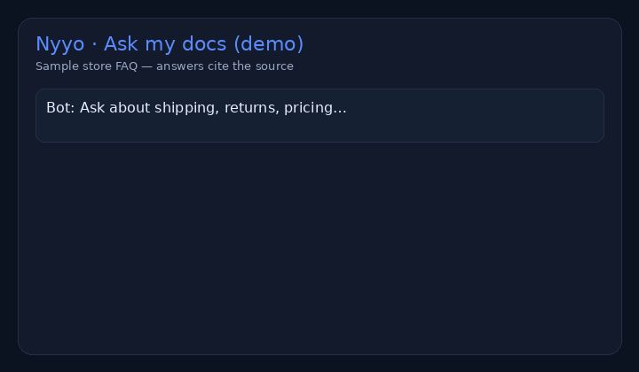

# AI chatbot on *your* documents (live demo)

> **For non-technical clients — start here**
>
> **What it does:** A chatbot that answers questions using only the documents you provide (FAQ, policies, product docs) — not random internet answers.
>
> **Try it in 1 click:** open the [**live demo**](https://nyyoautomation.github.io/nyyo-docs-chatbot/), click a suggested question (or type your own), and read the answer with its source section.
>
> **Business benefit:** fewer repetitive support emails (“shipping time?”, “refund window?”), faster staff onboarding. Typical build from **$199**.



**Live demo:** https://nyyoautomation.github.io/nyyo-docs-chatbot/  
**Brand:** [Nyyo Automation](https://github.com/nyyoautomation)

[](#)
[](#)
[](#)
[](#)

---

## What you get in this demo

- Sample **store FAQ** (shipping, returns, warranty, pricing, privacy, SLA)
- In-browser search (BM25) — **no signup, no paid API, no server**
- Answers that **cite the source** section

## How to run locally

```bash
# any static server
python3 -m http.server 8080
# open http://localhost:8080
```

Or just use the live Pages link above.

## What’s for sale

| | |
|---|---|
| **Product** | RAG chatbot on your PDF / Notion / FAQ — web widget or Telegram |
| **From** | **$199** |
| **Includes** | Your docs ingested · source citations · 7-day bugfix · you own the code |

→ [Packages & contact](https://github.com/nyyoautomation) · [LaborX — Nyyo Automation](https://laborx.com/freelancers/users/id475124)

## Hire me

1. Open an **issue** on this repo with: goal · deadline · budget  
2. Or message via **[LaborX — Nyyo Automation](https://laborx.com/freelancers/users/id475124)**

I reply with scope, price and ETA. Crypto: USDC on BNB Chain or Base.

## Limits (honest)

- This public demo uses **keyword search** over a fixed sample FAQ (fast & free). Client builds can use embeddings / LLM APIs when you provide a key or budget.
- Not a replacement for legal advice; sample store content is fictional.


## Free install kit included

No add-on fee. Downloads on the [live demo](https://nyyoautomation.github.io/nyyo-docs-chatbot/#install):

- WordPress plugin ZIP (`dist/nyyo-docs-chatbot-wordpress.zip`)
- Full kit ZIP (`dist/nyyo-docs-chatbot-install-kit.zip`) — Shopify snippet, universal script, Telegram/Slack/Discord templates

Anything not listed is **on request (free)**.
